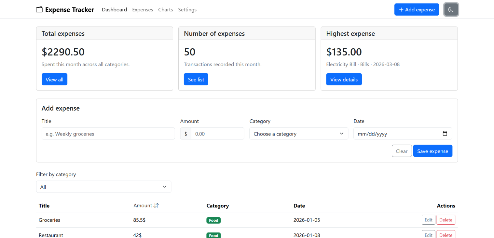
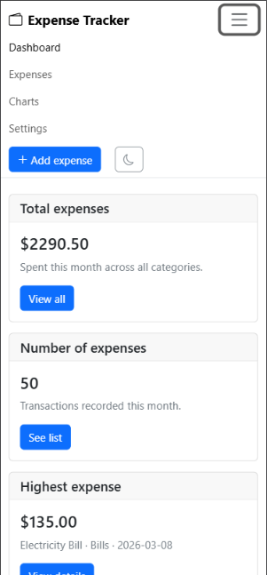
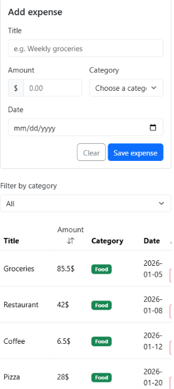

# Expense Tracker

The Expense Tracker app allows you to save and track your expenses. Expenses are saved in a PostgreSQL database, and you can filter them by category or sort them by amount. The app also provides useful insights, such as the highest expense, the total amount spent, and the number of expenses.

## How to run

### Backend

1. Create a PostgreSQL database named `expense_tracker`.

2. Run the `schema.sql` file in PostgreSQL to create the `expenses` table and its constraints.

3. Create a `.env` file in the backend folder and add your PostgreSQL configuration:

```env
DB_HOST=127.0.0.1
DB_PORT=your_postgres_port
DB_USER=your_postgres_user
DB_PASSWORD=your_postgres_password
DB_NAME=expense_tracker
```

4. Open a terminal in the backend folder and install the required packages:

```bash
npm install
```

5. Start the backend server:

```bash
node server.js
```

6. The backend should now be running on:

```text
http://localhost:5000
```

### Frontend

1. Open the frontend folder in VS Code.

2. Open `index.html` in your browser.

3. Make sure the backend server is running so the frontend can communicate with the API and PostgreSQL database.

## Features

- [x] Add an expense
- [x] Delete an expense
- [x] Edit an expense
- [x] Filter expenses by category
- [x] Sort expenses by amount
- [x] Summary cards showing total amount, number of expenses, and highest expense
- [x] Data is saved in a PostgreSQL database
- [x] Bootstrap alerts for success and error messages
- [x] Loading spinner while data is being loaded
- [x] Responsive design for smaller screens
- [x] Dark mode

## Screenshots





## What was the hardest part?

The hardest part was connecting the frontend, backend, and PostgreSQL database together and making sure that errors were handled correctly. I had to make sure that the backend validated the data before sending it to the database, and that the frontend displayed the error messages returned by the server. Testing the API endpoints with Thunder Client also helped me understand how the frontend communicates with the backend.

## Technologies Used

- HTML
- CSS
- JavaScript
- Bootstrap 5
- Node.js
- Express.js
- PostgreSQL
- `pg`
- CORS
- dotenv
